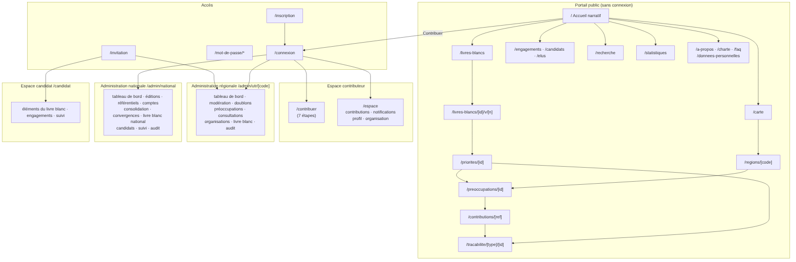
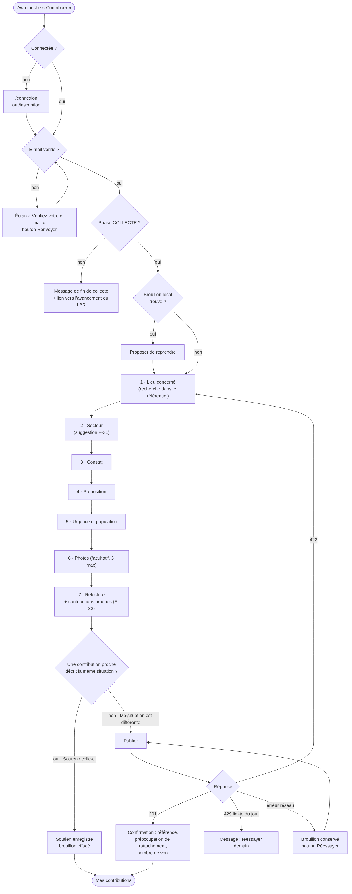
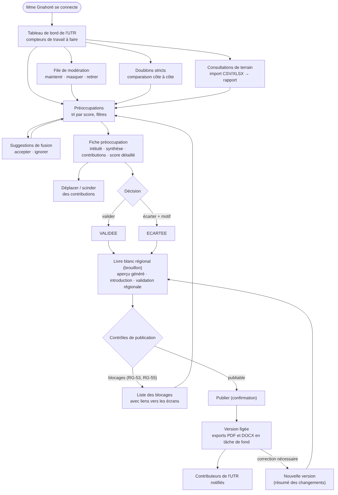
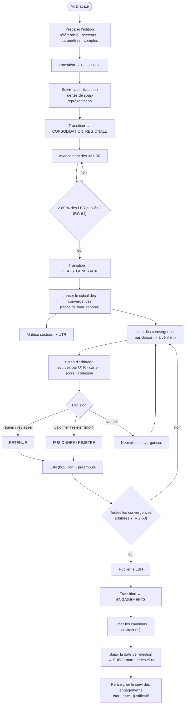

# APP_FLOW — Plan des écrans et parcours

| Champ | Valeur |
|---|---|
| Version | 1.0 — phase 3 (conception), soumise à validation |
| Références | `PRD.md` v1.1 (rôles §7, processus §8, fonctionnalités §11) · `API_SPECIFICATIONS.md` · `TRD.md` §4.3 (modes de rendu) |
| Suite | `UX_SPECIFICATIONS.md` détaille ce que chaque écran doit permettre, et la direction d’interface (tâche 0.8 du plan) sa présentation ; ce document fixe **quels** écrans existent, **qui** y accède et **comment** on passe de l’un à l’autre |

---

## 1. Plan du site

### 1.1 Portail public

| Route | Écran | Contenu principal | F | API |
|---|---|---|---|---|
| `/` | Accueil | Récit de la démarche (de la contribution à l'engagement), chiffres clés de l'édition active, appel à contribuer, accès à la carte | F-100 | `GET /portail/accueil` |
| `/carte` | Carte de participation | Carte des 33 UTR, choix de l'indicateur (participation pour 10 000 habitants, secteur dominant, état du LBR), tableau équivalent accessible | F-101 | `GET /portail/carte` |
| `/regions/[code]` | Page d'UTR | Chiffres, principales préoccupations, LBR publié, compteurs de transparence | F-102, F-132 | `GET /portail/utr/{code}`, `GET /transparence/{utr}` |
| `/preoccupations/[id]` | Préoccupation | Intitulé, synthèse, voix, score expliqué, contributions, engagements | F-102, F-103 | `GET /preoccupations/{id}` |
| `/livres-blancs` | Bibliothèque | LBR et LBN publiés, filtres par édition et UTR | F-82 | `GET /livres-blancs` |
| `/livres-blancs/[id]/v/[n]` | Lecture d'un livre blanc | Sommaire navigable, sections, téléchargements PDF et DOCX, versions précédentes | F-81, F-82, F-63 | `GET /livres-blancs/{id}/versions/{n}` |
| `/priorites/[id]` | Priorité du LBN | Classe, UTR concernées (carte), préoccupations sources, engagements des candidats | F-92, F-103 | `GET /priorites/{id}` |
| `/contributions/[ref]` | Contribution | Texte, lieu, soutiens, préoccupation de rattachement, bouton Soutenir | F-36, F-103 | `GET /contributions/{reference}` |
| `/tracabilite/[type]/[id]` | Fil de traçabilité | Chaîne contribution → préoccupation → LBR → priorité → LBN → engagements, dans les deux sens | F-103 | `GET /tracabilite/{type}/{id}` |
| `/recherche` | Recherche | Résultats par type (contributions, préoccupations, livres blancs), filtres | F-104 | `GET /recherche` |
| `/candidats`, `/candidats/[id]` | Candidats | Liste par élection ; engagements d'un candidat et leur suivi | F-92, F-93 | `GET /candidats…` |
| `/engagements` | Comparaison des engagements | Pour chaque priorité, les candidats engagés et leurs échéances | F-92 | `GET /priorites/{id}` |
| `/elus` | Tableau de bord des élus | Taux de réalisation par élu, secteur, échéance | F-94 | `GET /elus/tableau-de-bord` |
| `/statistiques` | Statistiques nationales | Participation, représentativité, alertes de sous-représentation | F-110, F-111 | `GET /statistiques/*` |
| `/organisations/[id]` | Organisation | Fiche publique, mention « vérifiée », contributions | F-15 | `GET /organisations/{id}` |
| `/a-propos/demarche`, `/a-propos/methode`, `/charte`, `/donnees-personnelles`, `/mentions-legales`, `/faq` | Pages d'information | Contenu éditorial ; la page Méthode expose les formules et les pondérations de l'édition | F-105 | — |
| `/archives` | Éditions clôturées | Accès en lecture seule | F-106 | `GET /editions` |

### 1.2 Accès

| Route | Écran | F |
|---|---|---|
| `/inscription` | Formulaire d'inscription (RG-10, RG-12) | F-10 |
| `/inscription/verification` | « Vérifiez votre boîte e-mail », renvoi possible | F-11 |
| `/verification-email?jeton=…` | Résultat de la vérification | F-11 |
| `/connexion` | Connexion ; redirection vers la page demandée avant connexion | F-12 |
| `/mot-de-passe/oubli`, `/mot-de-passe/nouveau?jeton=…` | Réinitialisation | F-13 |
| `/invitation?jeton=…` | Activation d'un compte d'administration ou de candidat | F-16 |

### 1.3 Espace contributeur

| Route | Écran | F |
|---|---|---|
| `/contribuer` | Formulaire en 7 étapes (§3.2) | F-30 à F-33 |
| `/espace` | Accueil personnel : dernières contributions, notifications, état de l'édition | F-34, F-120 |
| `/espace/contributions`, `/espace/contributions/[id]` | Mes contributions ; détail, historique, modification, retrait | F-34, RG-25 |
| `/espace/notifications` | Notifications | F-120, F-121 |
| `/espace/profil` | Profil, affichage du nom, mot de passe, export et suppression du compte | F-14 |
| `/espace/organisation` | Créer ou gérer son organisation, état de vérification | F-15 |

### 1.4 Administration régionale — `/admin/utr/[code]`

Si l'administrateur a plusieurs UTR, un sélecteur d'UTR figure dans l'en-tête ; sinon, `/admin` redirige directement vers son UTR.

| Route | Écran | F |
|---|---|---|
| `…/tableau-de-bord` | Travail à faire (modération, doublons, préoccupations proposées), participation par département et secteur, profils, avancement | F-55 |
| `…/moderation` | File de modération | F-40, F-42 |
| `…/doublons` | Doublons stricts suspects, comparaison côte à côte | F-41 |
| `…/preoccupations` | Liste filtrable, tri par score ou voix, validation par lot, suggestions de fusion | F-50, F-52, F-54 |
| `…/preoccupations/[id]` | Fiche : édition des textes, contributions, carte des localités, score détaillé, déplacer, scinder, valider, écarter | F-51, F-53, F-54 |
| `…/consultations` | Consultations de terrain : déclaration, import, rapports | F-35 |
| `…/organisations` | Organisations dont le siège est dans l'UTR, à vérifier | RG-15 |
| `…/livre-blanc` | Composition du LBR : aperçu, introduction, validation régionale, contrôles, publication, versions | F-60 à F-63 |
| `…/audit` | Journal des actions sur l'UTR | F-131 |

### 1.5 Administration nationale — `/admin/national`

| Route | Écran | F |
|---|---|---|
| `…/tableau-de-bord` | Avancement des 33 LBR, participation nationale, alertes | F-70, F-110 |
| `…/editions`, `…/editions/[id]` | Éditions : dates, paramètres (préparation), changement de phase avec préconditions | F-22, F-23 |
| `…/referentiels/territoires`, `…/referentiels/secteurs`, `…/referentiels/termes-interdits` | Référentiels | F-20, F-21, F-24 |
| `…/comptes` | Comptes d'administration, affectations, invitations | F-16 |
| `…/consolidation` | Calculs (lancement, rapports), matrice secteurs × UTR | F-71, F-72 |
| `…/convergences`, `…/convergences/[id]` | Liste par classe, écran d'arbitrage | F-73 |
| `…/decisions` | Journal des décisions des états généraux, export | F-74 |
| `…/livre-blanc-national` | Composition et publication du LBN | F-80, F-81 |
| `…/candidats`, `…/suivi` | Candidats, statut d'élu, suivi des engagements | F-90, F-93 |
| `…/organisations`, `…/audit` | Vérification des organisations (toutes UTR) ; journal complet | RG-15, F-131 |

L'administrateur national peut aussi ouvrir n'importe quel écran régional (`/admin/utr/[code]/…`).

### 1.6 Espace candidat — `/candidat`

| Route | Écran | F |
|---|---|---|
| `/candidat` | Synthèse : engagements pris, échéances, derniers suivis | F-91 |
| `/candidat/livre-blanc` | Éléments du livre blanc applicable (LBN pour la présidentielle, LBR de son UTR pour les régionales), avec l'action « M'engager » | F-91, RG-71 |
| `/candidat/engagements` | Engagements : retrait possible jusqu'à l'élection, commentaire des mises à jour du suivi | F-91, F-93, RG-73 |

### 1.7 Version mobile installée (F-38, D-16)

La version web s'utilise en ligne, sur ordinateur, tablette ou téléphone. La **version mobile** est la même application installée sur le téléphone depuis la page `/application-mobile` du portail (« Télécharger l'application mobile », lien dans l'en-tête et le pied de page) ; elle garde ce qu'il faut pour travailler sans réseau. Elle est réalisée une fois la version web terminée (lot 6).

| Route | Écran | Sans réseau |
|---|---|---|
| `/contribuer` | Formulaire de contribution | Oui : la contribution terminée part dans la file d'attente |
| `/espace/envois` | Contributions en attente d'envoi : état de chacune (en attente, envoyée, refusée et pourquoi), « Envoyer maintenant », « Modifier », « Supprimer » | Oui |
| `/espace/contributions` | Mes contributions (dernier état reçu, date de mise à jour affichée) | Oui, en lecture |
| `/livres-blancs/[id]/v/[n]` | Livres blancs déjà ouverts sur ce téléphone | Oui, en lecture |
| `/hors-connexion` | Page affichée pour toute autre page demandée sans réseau : ce qui reste possible, liens vers les écrans ci-dessus | Oui |

### 1.8 Impression

`/impression/livres-blancs/[id]/v/[n]` : mise en page A4 utilisée pour produire les PDF (TRD §7, §9.6). Elle n'est pas proposée dans la navigation.

---

## 2. Navigation selon le rôle

| Rôle | En-tête (bureau) | Barre inférieure (mobile) | Après connexion |
|---|---|---|---|
| Visiteur | Comprendre · Carte · Livres blancs · Engagements · Rechercher · **Contribuer** · Se connecter | Accueil · Carte · Livres blancs · Contribuer | — |
| Contributeur | Idem, avec « Mon espace » et la cloche des notifications | Accueil · Carte · **Contribuer** · Mon espace | Page demandée, sinon `/espace` |
| Administrateur régional | Menu latéral de l'UTR (§1.4) ; lien vers le portail | Usage principal sur ordinateur ; menu repliable sur tablette | `/admin/utr/[code]/tableau-de-bord` |
| Administrateur national | Menu latéral national (§1.5) | Idem | `/admin/national/tableau-de-bord` |
| Candidat | Mon espace candidat · Portail | Idem | `/candidat` |

Un compte qui cumule plusieurs rôles dispose d'un sélecteur d'espace dans le menu du compte.

---

## 3. Parcours

### 3.1 Fatou vérifie l'origine d'une priorité (visiteuse)

1. Depuis l'accueil, Fatou ouvre la carte, choisit l'indicateur « État des livres blancs » et sélectionne une région.
2. Elle ouvre le LBN publié, puis une priorité nationale.
3. Le panneau « D'où vient cette priorité ? » déroule, UTR par UTR, les préoccupations sources, leurs voix et quelques contributions.
4. Elle ouvre une contribution, puis remonte le fil dans l'autre sens jusqu'aux engagements des candidats sur cette priorité.

Points d'attention : chaque étape affiche la référence et la date de la version publiée consultée ; les données personnelles ne sont jamais visibles (RG-29).

### 3.2 Awa dépose une contribution (contributrice, mobile)

| Étape | Contenu | Contrôles |
|---|---|---|
| 1. Lieu | Champ de recherche (« Tapez le nom de votre commune ou sous-préfecture »), proposition par défaut du lieu de résidence | Maille sélectionnable (RG-21) |
| 2. Secteur | 14 cartes illustrées ; suggestion mise en avant si le texte est déjà saisi | Obligatoire |
| 3. Constat | « Qu'est-ce qui ne va pas ? » ; compteur de caractères ; exemple | 30 à 1 500 caractères |
| 4. Proposition | « Que proposez-vous ? » | 20 à 1 500 caractères |
| 5. Urgence et population | 4 niveaux expliqués en mots simples ; tranche de population facultative ; localité précise facultative | Urgence obligatoire |
| 6. Photos | Jusqu'à 3, compressées avant l'envoi | 5 Mo par photo (NF-14) |
| 7. Relecture | Récapitulatif modifiable ; « Au nom de… » si l'utilisateur représente une organisation ; contributions proches | — |

- Le titre est demandé à l'étape 3 (avec un exemple), car il résume le constat.
- Le brouillon est enregistré dans le navigateur à chaque étape ; une coupure de réseau ne fait rien perdre.
- Les contributions proches sont demandées dès que le constat est saisi (étape 3), pour être prêtes à l'étape 7 sans attente.
- Après publication, l'écran de confirmation montre la préoccupation de rattachement (« 54 personnes ont exprimé ce besoin dans le Gôh ») et invite à partager la contribution ou à en soutenir d'autres.

### 3.2 bis Awa contribue sans réseau (version mobile)

1. Awa a installé la version mobile lors d'un passage en ville. Au village, sans réseau, elle ouvre l'application : l'indicateur « Hors connexion » s'affiche.
2. Elle remplit les sept étapes. L'étape de relecture ne peut pas montrer les contributions proches ; une phrase l'explique (« Sans réseau, nous ne pouvons pas vous montrer les contributions semblables. Votre contribution sera regroupée avec elles à l'envoi. »).
3. « Publier » devient « Garder pour l'envoi ». La contribution apparaît dans « En attente d'envoi », avec la date limite de la collecte.
4. Au retour du réseau, l'application envoie la contribution sans autre action. Awa reçoit la confirmation habituelle (référence, préoccupation de rattachement).
5. Si la collecte s'est terminée entre-temps, la contribution reste sur le téléphone avec le message « La collecte s'est terminée le 15 janvier : cette contribution n'a pas pu être envoyée. » (RG-30).

### 3.3 Awa suit sa contribution

1. Une notification signale chaque évènement : contribution regroupée ou fusionnée, décision de modération (avec le motif), publication du LBR de sa région, publication du LBN (F-120).
2. Dans « Mes contributions », chaque contribution affiche une frise d'état : déposée → regroupée dans la préoccupation P → retenue dans le LBR (rang) → reprise dans la priorité nationale N → engagements.
3. Pendant la collecte, elle peut modifier ou retirer sa contribution ; après, ces actions disparaissent et une phrase explique pourquoi (RG-25).

### 3.4 Kouassi représente l'Association des jeunes d'Oumé

1. Depuis « Mon espace », il crée la fiche de l'organisation (dénomination, type, numéro d'enregistrement facultatif, siège). Il en devient le représentant (RG-14).
2. L'organisation est « non vérifiée » ; l'administrateur régional de l'UTR du siège la vérifie (RG-15). Kouassi est notifié.
3. À l'étape 7 du formulaire, il choisit « Au nom de l'Association des jeunes d'Oumé ». La contribution affiche le nom de l'association sur le portail (RG-29).
4. La réunion de 60 jeunes peut aussi être transmise à l'administrateur régional, qui l'importe comme consultation de terrain (D-10) : c'est le canal prévu pour donner du poids à une parole collective.

### 3.5 Mme Gnahoré prépare le livre blanc du Gôh (administratrice régionale)

- **Pendant la collecte** : traitement au fil de l'eau de la file de modération et des doublons ; imports des consultations de terrain ; premières validations de préoccupations.
- **Après la clôture de la collecte** (phase `CONSOLIDATION_REGIONALE`) : traitement des suggestions de fusion, correction des rattachements, validation ou écartement de toutes les préoccupations, puis composition du LBR.
- **Publication** : l'écran de composition affiche en permanence les contrôles de publication (§5.6 de l'API). Le bouton « Publier » n'est actif qu'en l'absence de blocage ; la confirmation rappelle que la version sera figée et qu'une correction exigera une nouvelle version (RG-54, RG-56).

### 3.6 M. Diabaté conduit la consolidation nationale (administrateur national)

- **Changement de phase** : l'écran de transition liste les préconditions (vérifiées ou non) et les effets (par exemple « Les contributeurs ne pourront plus déposer ») ; une saisie de confirmation est demandée (F-23).
- **Arbitrage** : l'écran d'une convergence présente côte à côte les préoccupations sources par UTR, la carte des UTR concernées, le score détaillé, la cohésion et les convergences voisines. Les actions sont accessibles au clavier, et chaque décision qui l'exige ouvre un champ de motif (RG-63, RG-64). Un compteur « reste à arbitrer » suit l'avancement.
- **Après le LBN** : création des candidats (invitations), saisie de la date de l'élection, puis du statut d'élu, et suivi des engagements.

### 3.7 L'équipe d'un candidat déclare ses engagements

1. Le candidat reçoit une invitation par e-mail et active son compte (`/invitation`).
2. Dans « Livre blanc », il parcourt les priorités applicables (LBN ou LBR de son UTR), filtrées par secteur et par classe.
3. « M'engager » ouvre un formulaire : échéance (année) et texte de l'engagement (20 à 1 000 caractères). Un engagement déjà pris sur l'élément est affiché à la place du bouton (RG-72).
4. Jusqu'à la date de l'élection, il peut retirer un engagement, qui reste visible comme retiré (RG-73).
5. En phase `SUIVI`, s'il est élu, il peut commenter publiquement chaque mise à jour saisie par l'administration (F-93).

---

## 4. Ce que chacun voit selon la phase

| Phase | Visiteur | Contributeur | Admin régional | Admin national | Candidat |
|---|---|---|---|---|---|
| `PREPARATION` | Pages d'information ; archives | Profil, organisation | Lecture de son UTR | Paramétrage complet | — |
| `COLLECTE` | Contributions publiées, préoccupations, carte de participation | **Dépôt**, modification, soutien, signalement | Modération, doublons, imports, préoccupations | Suivi de la participation | — |
| `CONSOLIDATION_REGIONALE` | Idem ; LBR au fur et à mesure de leur publication | Bandeau « collecte terminée » ; suivi de ses contributions | Finalisation et **publication du LBR** ; imports de terrain encore possibles | Avancement des LBR | — |
| `ETATS_GENERAUX` | LBR publiés ; annonce des états généraux | Suivi | Lecture ; nouvelle version de LBR impossible | **Consolidation, arbitrage, LBN** | — |
| `ENGAGEMENTS` | **LBN**, comparaison des engagements | Suivi ; notification de publication du LBN | Lecture | Candidats ; date de l'élection | **Déclaration et retrait** d'engagements |
| `SUIVI` | Tableau de bord des élus | Idem | Lecture | **Suivi des réalisations** | Commentaires (élus) |
| `CLOTUREE` | Archives | Archives | Lecture | Lecture ; ouverture d'une nouvelle édition | Lecture |

La phase courante est rappelée dans l'en-tête de tous les espaces connectés. Une action indisponible dans la phase n'est pas cachée sans explication : elle est remplacée par une phrase qui dit quand elle le sera, ou pourquoi elle ne l'est plus.

---

## 5. États des écrans

| Situation | Comportement attendu |
|---|---|
| Version mobile sans réseau | Indicateur discret « Hors connexion » ; les actions qui exigent le réseau (soutenir, signaler, suggestions de contributions proches) sont remplacées par une phrase qui dit qu'elles reviendront avec le réseau |
| Chargement d'une liste | Squelettes à la forme des éléments ; jamais de page blanche |
| Liste vide | Message qui explique et propose l'action suivante (« Aucune préoccupation à valider. Les nouvelles contributions apparaîtront ici. ») |
| Erreur de validation | Message sous le champ, dans les mots de l'utilisateur (API §2.1), focus placé sur le premier champ en erreur |
| Règle de gestion (`409`) | Message explicite, avec un lien vers l'écran qui permet de lever le blocage quand il existe |
| Hors périmètre ou introuvable | Page « Cette page n'existe pas ou vous n'y avez pas accès », lien vers son espace |
| Session expirée | Retour à la connexion, puis à la page en cours ; un brouillon de contribution n'est pas perdu |
| Réseau perdu | Bandeau discret ; les envois échoués proposent « Réessayer » |
| Tâche de fond en cours | Indicateur dans l'écran concerné et notification à la fin (exports, calcul, import) |
| Objet modifié par un autre administrateur (`412`) | Message proposant de recharger, sans perte de la saisie en cours (copie affichée) |

---

## 6. Notifications

| Évènement | Destinataire | Application | E-mail |
|---|---|---|---|
| Inscription, demande de réinitialisation, invitation | Titulaire du compte | — | Oui (obligatoire) |
| Contribution regroupée dans une préoccupation existante ou fusionnée | Auteur | Oui | Selon préférences |
| Décision de modération (avec motif) | Auteur | Oui | Oui |
| Organisation vérifiée ou rejetée | Représentant | Oui | Oui |
| LBR de sa région publié | Contributeurs de l'UTR | Oui | Selon préférences |
| LBN publié | Tous les contributeurs | Oui | Selon préférences |
| Export ou calcul terminé | Demandeur | Oui | Non |
| Nouvelle mise à jour du suivi d'un de ses engagements | Candidat | Oui | Oui |

---

## 7. Correspondance avec les traitements MERISE

Les parcours ci-dessus mettent en œuvre les opérations du MCT (`MERISE_TRAITEMENTS.md`) :

| Parcours | Opérations du MCT |
|---|---|
| 3.2, 3.3 Inscription, contribution et suivi | OP1 à OP4 (MCT 1 : comptes ; MCT 2 : collecte et modération) |
| 3.5 Livre blanc régional | OP5 à OP7 (MCT 3 : consolidation régionale) |
| 3.6 Consolidation nationale | OP8 à OP10 (MCT 4) |
| 3.7 Engagements, et suivi par l'administration | OP11 et OP12 (MCT 5) |
