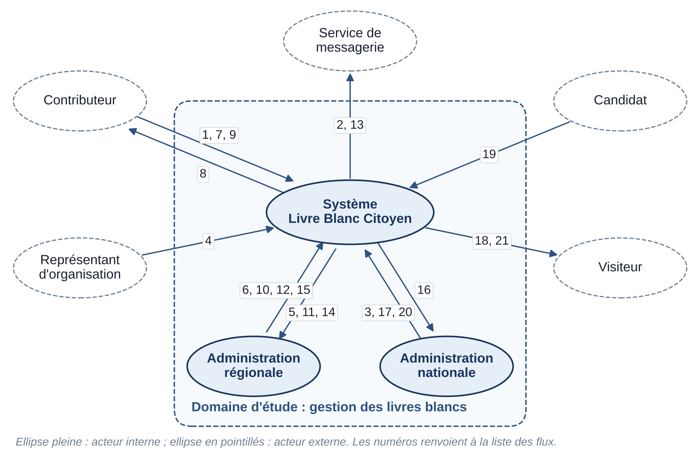
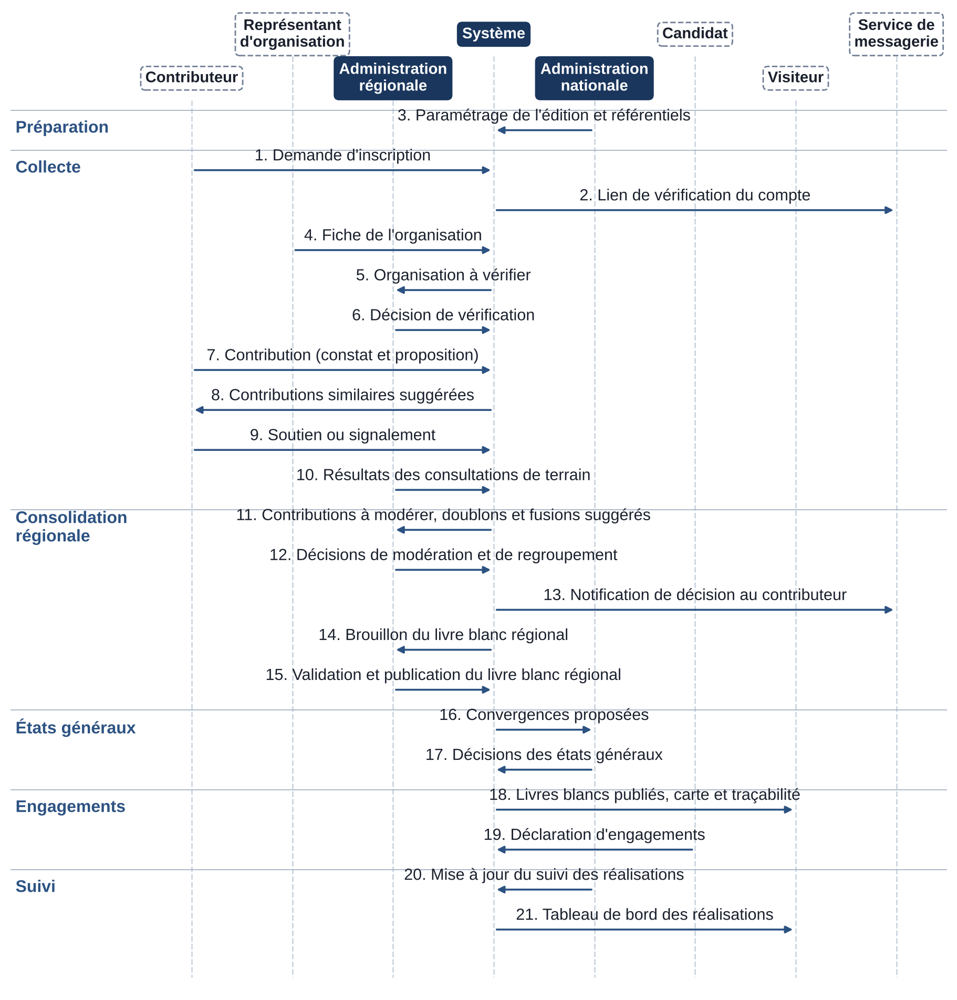
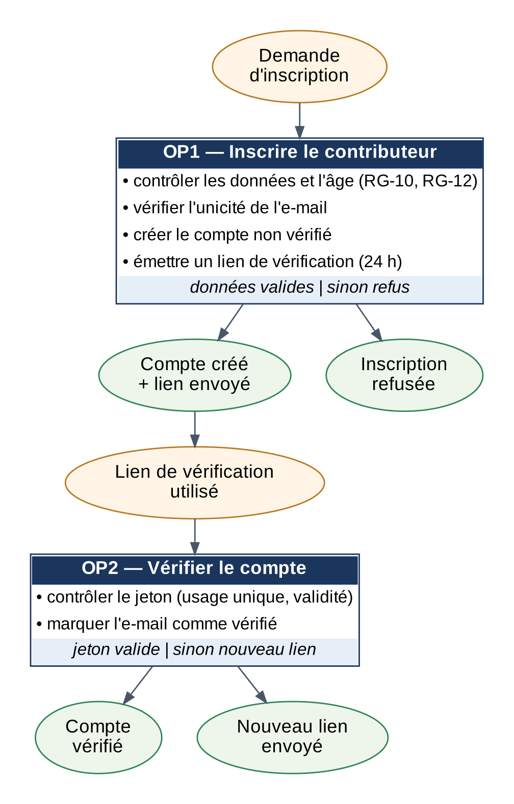
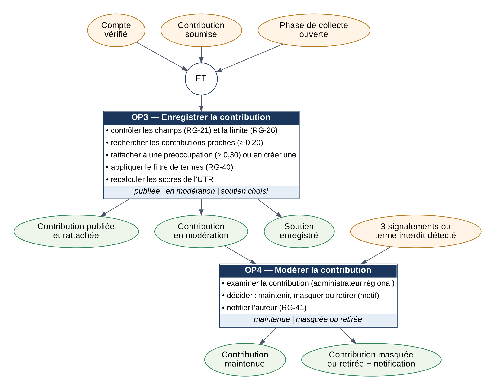
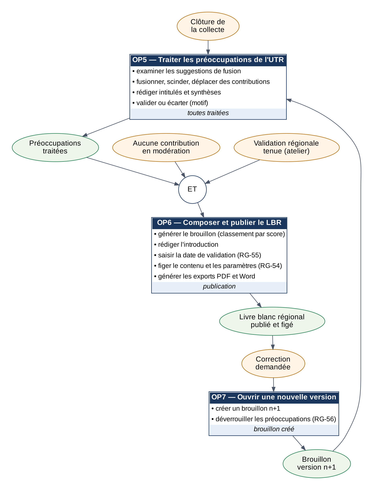
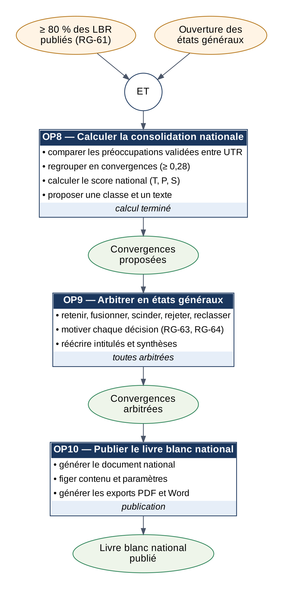
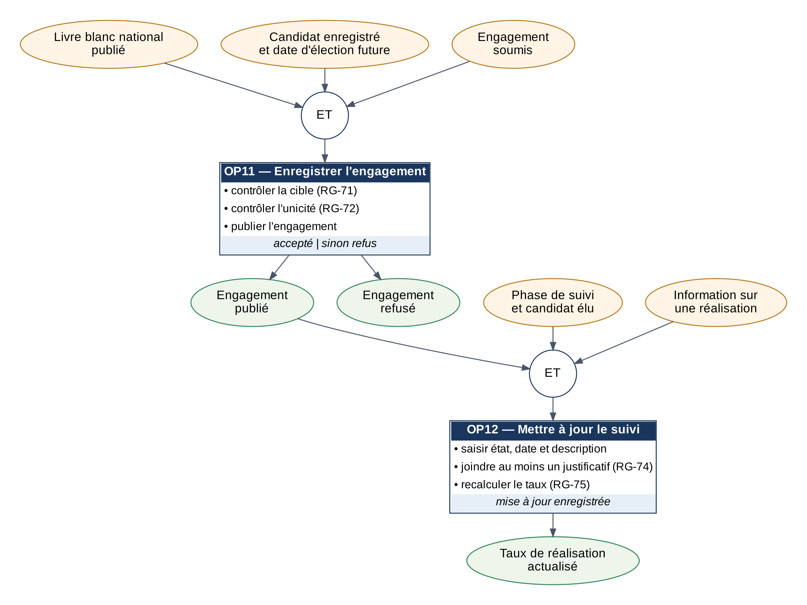

# MERISE — Modèles de communication et de traitements

| Champ | Valeur |
|---|---|
| Version | 1.0 — phase 3 (conception), soumise à validation |
| Références | `PRD.md` v1.1 (règles RG, fonctionnalités F), `DATABASE_SCHEMA.md` (MCD, MLD, MPD) |
| Diagrammes | `diagrams/merise/` — générés par `database/mcd/generer_traitements.py` (MCC, ordonnancement, cinq vues du MCT) |

Ce document couvre la partie « traitements » de la méthode MERISE retenue au chapitre II du rapport : modèle conceptuel de communication (MCC), diagramme d'ordonnancement des flux, modèle conceptuel des traitements (MCT) et modèle organisationnel des traitements (MOT). La partie « données » (MCD, MLD, MPD) se trouve dans `DATABASE_SCHEMA.md`.

---

## 1. Modèle conceptuel de communication (MCC)

### 1.1 Acteurs

| Acteur | Nature | Rôle dans les échanges |
|---|---|---|
| Contributeur | Externe | Personne physique inscrite qui dépose, soutient et signale des contributions |
| Représentant d'organisation | Externe | Contributeur qui gère la fiche d'une organisation et dépose en son nom |
| Candidat | Externe | Déclare ses engagements sur les livres blancs publiés |
| Visiteur | Externe | Consulte le portail public |
| Service de messagerie | Externe | Achemine les e-mails (vérification, notifications) |
| Système Livre Blanc Citoyen | Interne | Enregistre, analyse, calcule, compose et publie |
| Administration régionale | Interne | Modère, traite les préoccupations, publie le livre blanc régional (une par UTR) |
| Administration nationale | Interne | Paramètre, conduit les états généraux, publie le livre blanc national, suit les réalisations |

Les administrations sont des acteurs **internes** : elles font partie de l'organisation qui opère la démarche (autorité de gouvernance, hypothèse H-01).

### 1.2 Diagramme

### 1.3 Liste des flux

| N° | Émetteur | Récepteur | Flux | Phase |
|---|---|---|---|---|
| 1 | Contributeur | Système | Demande d'inscription | Collecte |
| 2 | Système | Messagerie | Lien de vérification du compte | Collecte |
| 3 | Administration nationale | Système | Paramétrage de l'édition et référentiels | Préparation |
| 4 | Représentant d'organisation | Système | Fiche de l'organisation | Collecte |
| 5 | Système | Administration régionale | Organisation à vérifier | Collecte |
| 6 | Administration régionale | Système | Décision de vérification | Collecte |
| 7 | Contributeur | Système | Contribution (constat et proposition) | Collecte |
| 8 | Système | Contributeur | Contributions similaires suggérées | Collecte |
| 9 | Contributeur | Système | Soutien ou signalement | Collecte |
| 10 | Administration régionale | Système | Résultats des consultations de terrain | Collecte (import encore possible en consolidation régionale, RG-28) |
| 11 | Système | Administration régionale | Contributions à modérer, doublons et fusions suggérés | Consolidation régionale |
| 12 | Administration régionale | Système | Décisions de modération et de regroupement | Consolidation régionale |
| 13 | Système | Messagerie | Notification de décision au contributeur | Consolidation régionale |
| 14 | Système | Administration régionale | Brouillon du livre blanc régional | Consolidation régionale |
| 15 | Administration régionale | Système | Validation et publication du livre blanc régional | Consolidation régionale |
| 16 | Système | Administration nationale | Convergences proposées | États généraux |
| 17 | Administration nationale | Système | Décisions des états généraux | États généraux |
| 18 | Système | Visiteur | Livres blancs publiés, carte et traçabilité | Engagements |
| 19 | Candidat | Système | Déclaration d'engagements | Engagements |
| 20 | Administration nationale | Système | Mise à jour du suivi des réalisations | Suivi |
| 21 | Système | Visiteur | Tableau de bord des réalisations | Suivi |

Remarque : les flux 11 à 13 peuvent commencer dès la collecte (modération au fil de l'eau). Ils sont rangés dans la phase où ils sont les plus nombreux.

---

## 2. Diagramme d'ordonnancement des flux

Le diagramme ci-dessous range les flux dans l'ordre chronologique des phases d'une édition (PRD §8.1). Chaque colonne correspond à un acteur et chaque flèche à un flux.

---

## 3. Modèle conceptuel des traitements (MCT)

### 3.1 Conventions

- **Événement** (ellipse orange) : fait daté qui déclenche un traitement. Un événement peut être externe (une demande) ou résulter d'un autre traitement.
- **Synchronisation** (cercle « ET ») : condition qui exige que plusieurs événements soient réunis.
- **Opération** (rectangle) : suite d'actions exécutées sans interruption. La dernière ligne indique ses **règles d'émission**.
- **Résultat** (ellipse verte) : événement produit par l'opération.

Le MCT décrit **quoi** faire, indépendamment de **qui** le fait et **quand** : ces aspects relèvent du MOT (§4).

Le MCT est présenté en cinq vues, une par grande étape, pour rester lisible.

### 3.2 MCT 1 — Comptes

| Opération | Événements déclencheurs | Règles appliquées | Résultats |
|---|---|---|---|
| OP1 Inscrire le contributeur | Demande d'inscription | RG-10, RG-12, unicité de l'e-mail | Compte créé et lien envoyé, ou inscription refusée |
| OP2 Vérifier le compte | Lien de vérification utilisé | Jeton à usage unique, validité 24 h | Compte vérifié, ou nouveau lien |

### 3.3 MCT 2 — Collecte et modération

| Opération | Événements déclencheurs | Règles appliquées | Résultats |
|---|---|---|---|
| OP3 Enregistrer la contribution | Contribution soumise **ET** compte vérifié **ET** phase de collecte ouverte | RG-20 à RG-27, §10.1 et §10.2 | Contribution publiée et rattachée, contribution en modération, ou soutien enregistré |
| OP4 Modérer la contribution | 3 signalements, terme interdit détecté, ou contribution mise en modération | RG-40 à RG-44 | Contribution maintenue, ou masquée ou retirée avec notification |

### 3.4 MCT 3 — Consolidation régionale

| Opération | Événements déclencheurs | Règles appliquées | Résultats |
|---|---|---|---|
| OP5 Traiter les préoccupations de l'UTR | Clôture de la collecte (ou brouillon n+1) | RG-43, RG-50, RG-52, §10.2 | Préoccupations traitées |
| OP6 Composer et publier le LBR | Préoccupations traitées **ET** aucune contribution en modération **ET** validation régionale tenue | RG-53 à RG-55, §10.3 | Livre blanc régional publié et figé |
| OP7 Ouvrir une nouvelle version | Correction demandée | RG-54, RG-56 | Brouillon de version n+1 |

### 3.5 MCT 4 — Consolidation nationale

| Opération | Événements déclencheurs | Règles appliquées | Résultats |
|---|---|---|---|
| OP8 Calculer la consolidation nationale | Au moins 80 % des LBR publiés **ET** ouverture des états généraux | RG-60, RG-61, §10.4 | Convergences proposées |
| OP9 Arbitrer en états généraux | Convergences proposées | RG-62 à RG-64 | Convergences arbitrées |
| OP10 Publier le livre blanc national | Convergences arbitrées | RG-65 | Livre blanc national publié |

### 3.6 MCT 5 — Engagements et suivi

| Opération | Événements déclencheurs | Règles appliquées | Résultats |
|---|---|---|---|
| OP11 Enregistrer l'engagement | LBN publié **ET** candidat enregistré **ET** date d'élection future **ET** engagement soumis | RG-70 à RG-73 | Engagement publié, ou refus |
| OP12 Mettre à jour le suivi | Phase de suivi **ET** candidat élu **ET** information sur une réalisation | RG-74, RG-75 | Taux de réalisation actualisé |

---

## 4. Modèle organisationnel des traitements (MOT)

Le MOT précise, pour chaque opération du MCT, **qui** exécute chaque tâche (poste de travail), **quand** (phase) et **comment** :

- **M** : manuelle, hors du système (réunion, atelier) ;
- **A** : automatique, exécutée par le système sans intervention ;
- **I** : interactive (conversationnelle), exécutée par un utilisateur à l'écran avec l'aide du système.

### 4.1 Comptes et collecte (phase COLLECTE)

| Opération | Tâche | Poste | Nature | Fonctionnalité |
|---|---|---|---|---|
| OP1 | Saisir le formulaire d'inscription | Contributeur | I | F-10 |
| OP1 | Contrôler les champs, l'âge et l'unicité de l'e-mail ; créer le compte ; envoyer le lien | Système | A | F-10, F-11 |
| OP2 | Ouvrir le lien reçu | Contributeur | I | F-11 |
| OP2 | Contrôler le jeton, marquer l'e-mail vérifié | Système | A | F-11 |
| OP3 | Saisir la contribution en étapes (lieu, secteur, constat, proposition, urgence, photos) | Contributeur | I | F-30, F-33 |
| OP3 | Suggérer le secteur ; rechercher et afficher les contributions proches | Système | A | F-31, F-32 |
| OP3 | Choisir de soutenir une contribution existante ou de publier | Contributeur | I | F-32, F-36 |
| OP3 | Enregistrer, filtrer, rattacher à une préoccupation, programmer le recalcul des scores | Système | A | F-30, §10.2 |
| OP3 bis | Organiser un atelier de consultation dans une localité | Administration régionale | M | — |
| OP3 bis | Importer le fichier des contributions de l'atelier, corriger les lignes rejetées | Administration régionale | I | F-35 |
| OP4 | Signaler une contribution | Contributeur | I | F-37 |
| OP4 | Mettre en modération (filtre ou 3 signalements) | Système | A | RG-40 |
| OP4 | Examiner et décider (maintenir, masquer, retirer, avec motif) | Administration régionale | I | F-40, F-41 |
| OP4 | Notifier l'auteur | Système | A | F-42, F-120 |
| — | Vérifier une organisation | Administration régionale | I | RG-15 |

### 4.2 Consolidation régionale (phase CONSOLIDATION_REGIONALE)

| Opération | Tâche | Poste | Nature | Fonctionnalité |
|---|---|---|---|---|
| OP5 | Calculer les suggestions de fusion et les scores | Système | A | F-52, §10.3 |
| OP5 | Fusionner, scinder, déplacer ; rédiger intitulés et synthèses ; valider ou écarter | Administration régionale | I | F-50 à F-54 |
| OP6 | Générer le brouillon du LBR | Système | A | F-60 |
| OP6 | Rédiger l'introduction, relire | Administration régionale | I | F-61 |
| OP6 | Tenir l'atelier de validation régionale | Administration régionale avec les parties prenantes | M | RG-55 |
| OP6 | Saisir la validation (date, lieu, PV) et publier | Administration régionale | I | F-62 |
| OP6 | Figer le contenu, générer les exports PDF et Word, notifier les contributeurs de l'UTR | Système | A | F-62, F-81, F-120 |
| OP7 | Ouvrir une nouvelle version | Administration régionale | I | F-63 |

### 4.3 États généraux (phase ETATS_GENERAUX)

| Opération | Tâche | Poste | Nature | Fonctionnalité |
|---|---|---|---|---|
| OP8 | Ouvrir la phase (préconditions contrôlées) | Administration nationale | I | F-23 |
| OP8 | Lancer le calcul | Administration nationale | I | F-71 |
| OP8 | Comparer, regrouper, calculer les scores, proposer les classes et les textes | Système | A | F-71, §10.4 |
| OP9 | Tenir les séances des états généraux | Administration nationale avec les délégations | M | — |
| OP9 | Enregistrer les décisions (retenir, fusionner, scinder, rejeter, reclasser) avec motif | Administration nationale | I | F-73, F-74 |
| OP10 | Rédiger le préambule, relire, publier | Administration nationale | I | F-80 |
| OP10 | Figer, générer les exports, notifier | Système | A | F-80, F-81, F-120 |

### 4.4 Engagements et suivi (phases ENGAGEMENTS et SUIVI)

| Opération | Tâche | Poste | Nature | Fonctionnalité |
|---|---|---|---|---|
| — | Créer les comptes candidats | Administration nationale | I | F-90 |
| OP11 | Déclarer ou retirer un engagement | Candidat | I | F-91 |
| OP11 | Contrôler la cible et l'unicité ; publier | Système | A | RG-71 à RG-73 |
| — | Marquer les élus après l'élection | Administration nationale | I | F-90 |
| OP12 | Recueillir l'information sur une réalisation | Administration nationale | M | — |
| OP12 | Saisir l'état, la description et les justificatifs | Administration nationale | I | F-93 |
| OP12 | Publier un commentaire (droit de réponse) | Candidat | I | F-93 |
| OP12 | Recalculer les taux de réalisation | Système | A | F-94 |

---

## 5. Correspondance avec les autres livrables

| Élément | Où il se retrouve |
|---|---|
| Flux du MCC | Points d'API (`API_SPECIFICATIONS.md`) et écrans (`APP_FLOW.md`) |
| Opérations du MCT | Services métier du serveur (`TRD.md` §4.2 et §5) et tâches de fond |
| Tâches automatiques du MOT | Fonctions de service et files de tâches (`TRD.md` §8) |
| Tâches interactives du MOT | Écrans et parcours (`APP_FLOW.md`) |
| Règles citées | Contraintes et déclencheurs SQL (`DATABASE_SCHEMA.md` §5) et validations applicatives |
